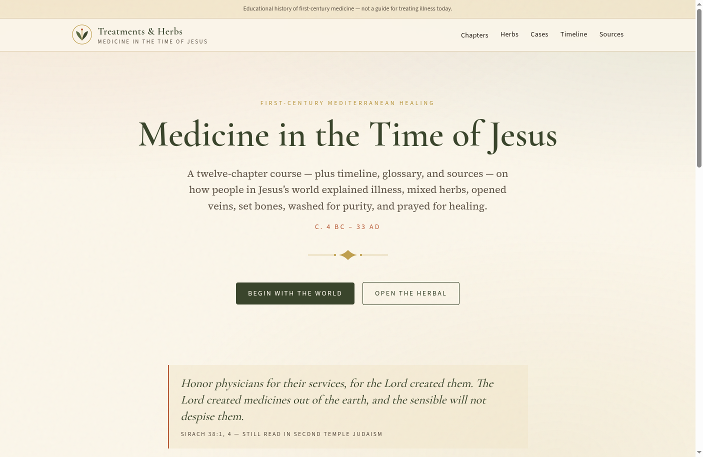

# Treatments & Herbs


[](https://first-century-medicine.vercel.app/)

**Live site:** [https://first-century-medicine.vercel.app/](https://first-century-medicine.vercel.app/)

Educational Next.js site on medicine, treatments, and herbal remedies in the first-century Mediterranean world — the lifetime of Jesus.

The original brief is in `ancient-medicine-playbook.md`. The built site expands that outline with chapters on physicians, Judea, a timeline, a [words and abbreviations](https://first-century-medicine.vercel.app/words) page, sources, and an interactive herbal.

## Run locally

```bash
npm install
npm run dev
```

Open [http://localhost:3000](http://localhost:3000).

## Contents

1. Introduction
2. Physicians and writers
3. Healing in Judea
4. The four humors
5. Bloodletting
6. Bathing, heat, and cold
7. Herbs (filterable materia medica)
8. Oils and poultices
9. Food as medicine
10. Surgery
11. Faith and healing
12. Ten reconstructed cases
13. Timeline, [words and abbreviations](https://first-century-medicine.vercel.app/words), sources

History only — not medical advice.
